<h1 align="center">👋 Hey, moi c’est Tya Desmet</h1>

💻 Étudiante en Bachelier technologie de l'informatique  !   
🌈 Développeuse front-end en devenir, explorant peu à peu le full-stack  

---

### 🚀 Tech Stack

  
  
  
  
  
  
  

---

### 📊 GitHub Stats

  

---

### 🏆 GitHub Trophies

  

---

### ✨ À propos de moi

💡 J’adore apprendre, comprendre et construire des projets qui allient **créativité** et **logique**.  
🎨 J’aime aussi tout ce qui touche au **design web** et à l’**expérience utilisateur**.  
🌍 Je vise une carrière de **développeuse full stack** — et pourquoi pas, **créatrice d'experience complète web (UI-UX + DEV)**.  
📚 Actuellement, je perfectionne :
- JavaScript & React pour le front / Node pour le back
- Java spingBoot / kotlin 
- C / c# et C++
- PHP & Laravel
- 
### 📫 Me contacter

  
  
  
  

---

  🌸 "Le code est une forme d’art, et chaque bug une opportunité d’apprendre." 🌸

